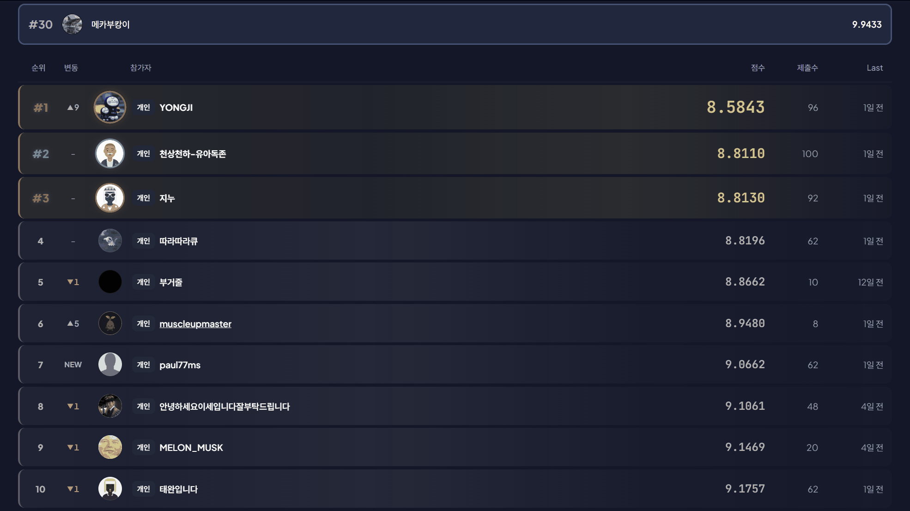
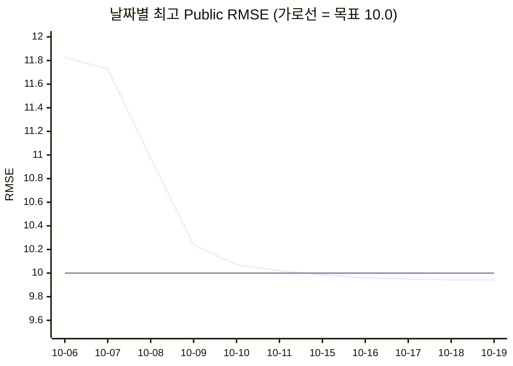
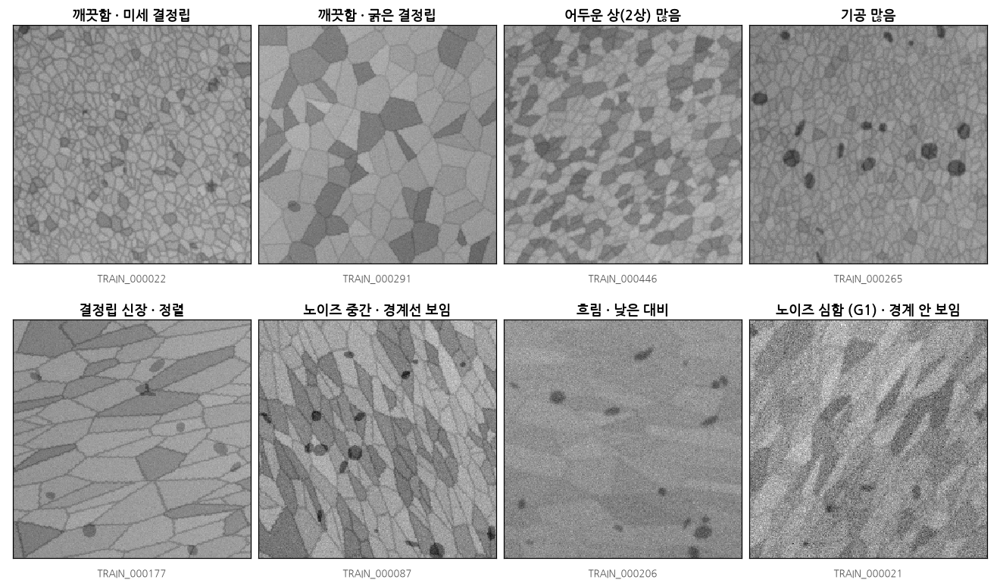
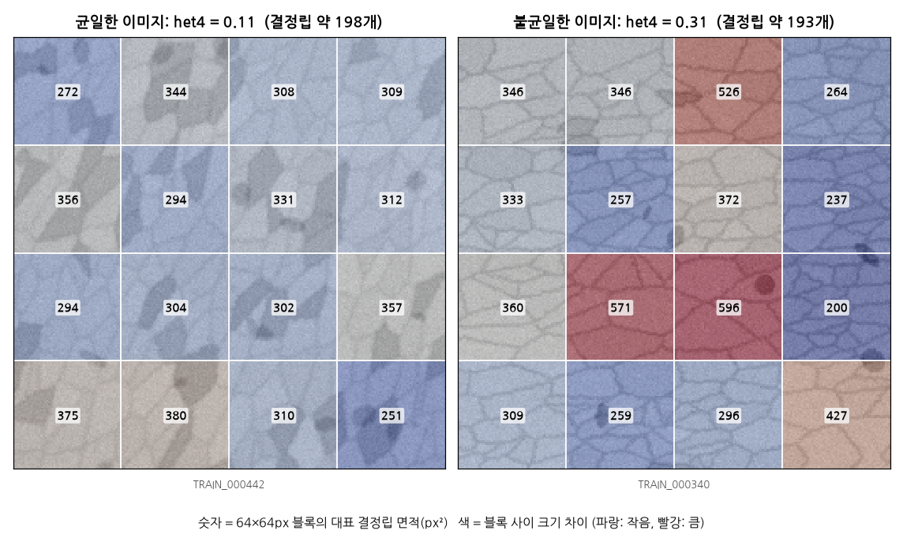
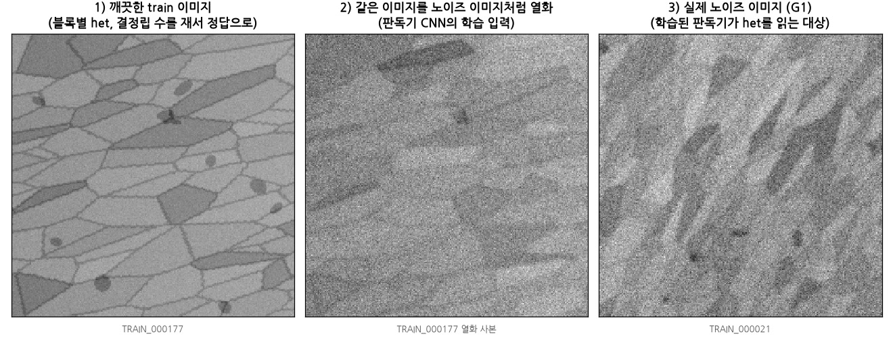
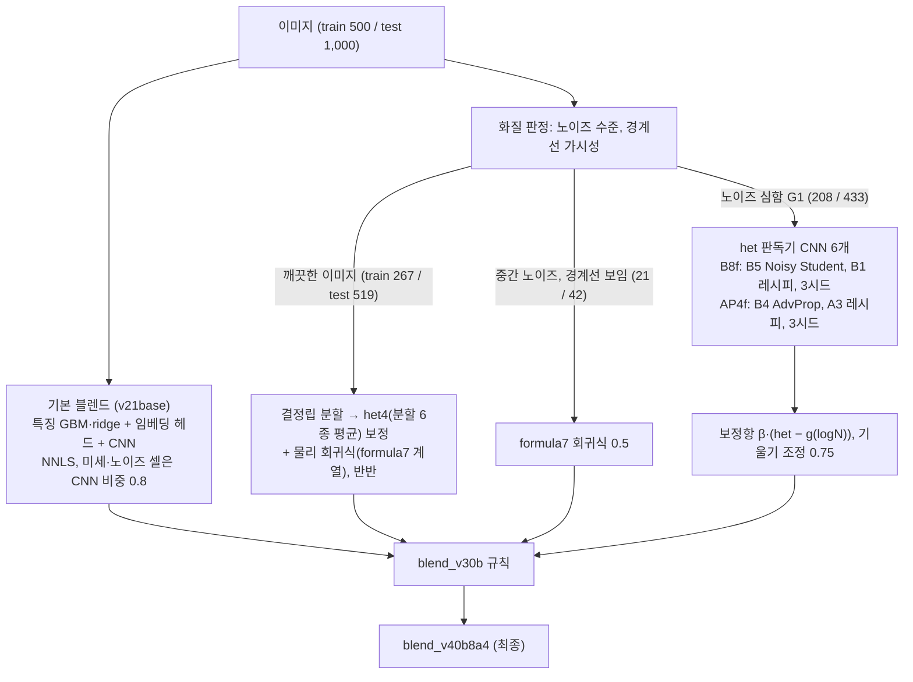

# 합성 미세구조 이미지 경도 예측: 프로젝트 보고서

데이커(daker.ai) 해커톤 「2D 합성 미세구조 이미지로부터 경도(hardness) 대용값 예측」 참가 기록이다.
2026-10-05부터 마감인 2026-10-19 10:00(KST)까지 15일 동안 진행했고, 이 문서는 그동안의 시행착오를 중심으로 정리한 최종 보고서다.

## 결과 요약

| 항목 | 결과 |
|---|---|
| 최종 제출 파일 | `blend_v40b8a4` |
| Public RMSE | **9.9433** (9.9433362872) |
| Private RMSE | **10.6187** (10.6186914819) |
| 최종 석차 | **30위 / 414팀** (개인으로만 참가할 수 있었던 해커톤) |
| 목표 | Public 10점 이하 → **달성** (10-15 처음 9.9868, 최종 9.9433) |
| 제출 기록 | Public 점수를 확인한 제출 51회 (하루 최대 5회) |



*대회 종료 후 리더보드 화면. 맨 위 고정 줄이 내 순위(#30, 9.9433)이고, 그 아래는 1~10위다.*

- 처음에 세운 목표는 리더보드 public 점수 **10점 이하**였다. 작업 11일째인 10-15에 9.9868로 처음 10점 아래로 내려갔고, 마지막 날 9.9433까지 낮춰 **목표를 달성했다**.
- 첫 제출(12.3454)에서 최종 제출(9.9433)까지 public RMSE를 2.40 낮췄다.
- 진행 중에 9점 이하와 8점대를 추가 도전 목표로 올려 잡았지만 그 수준에는 이르지 못했다. 남은 오차의 대부분이 이미지에 담긴 정보의 한계에서 온다는 것을 분석으로 확인했다([6장](#6-남은-오차의-정체-8점대가-어려웠던-이유)).
- Private은 public보다 0.675 높았지만, 대회 내내 판단 기준으로 삼은 정직한 nested CV(10.4395)와는 0.18 차이였다. Public과 private을 합친 test 1,000장 전체로 환산하면 10.42로 CV와 거의 같다([7장](#7-public과-private의-차이)).



## 목차

1. [문제와 제약](#1-문제와-제약)
2. [프로젝트 운영: 내가 정한 방향과 결정](#2-프로젝트-운영-내가-정한-방향과-결정)
3. [실험 규약](#3-실험-규약)
4. [시행착오의 기록](#4-시행착오의-기록)
5. [효과가 없었던 시도](#5-효과가-없었던-시도)
6. [남은 오차의 정체: 8점대가 어려웠던 이유](#6-남은-오차의-정체-8점대가-어려웠던-이유)
7. [Public과 Private의 차이](#7-public과-private의-차이)
8. [배운 점](#8-배운-점)
9. [최종 모델 구성](#9-최종-모델-구성)
10. [코드 구조와 재현](#10-코드-구조와-재현)
11. [대회 규칙 준수](#11-대회-규칙-준수)
- [부록: 전체 제출 기록 (51회)](#부록-전체-제출-기록-51회)

---

## 1. 문제와 제약

- **입력과 출력**: 256×256 크기의 8비트 흑백 합성 미세구조 이미지 한 장에서 경도 대용값(HV)을 예측한다. 평가는 RMSE.
- **데이터**: train 500장(정답 있음), test 1,000장. Public 점수는 test의 30%(300장), private 점수는 나머지 70%(700장)로 매기고, 최종 순위는 private 100%로 정한다.
- **정답이 만들어진 방식**: 공식 설명 자료에 따르면 정답은 재료과학의 경향을 본떠 합성한 값이다. 결정립 크기(Hall-Petch), 두 상의 혼합(어두운 상), 기공, 결정립의 신장과 정렬, 결정립 크기 분포의 균일도와 공간적 불균일성이 경도에 반영된다.
- **핵심 난점**: 같은 구조라도 영상 품질(잡음, 흐림, 대비, 선 모양 잡음)이 이미지마다 크게 다르다. 노이즈가 심한 이미지에서는 결정립 경계가 아예 보이지 않는다. 이런 이미지(이하 G1)가 train 208장, test 433장으로 전체의 약 40%였고, 제곱오차의 절반 이상이 이런 이미지에서 나왔다.
- **규칙**: 외부 데이터 금지, test 이미지는 어떤 형태로도 학습에 사용 금지, 공개 라이선스(MIT, Apache 2.0, CC BY, CC BY-NC) 사전학습 가중치만 허용, 원격 API 모델 금지, 하루 제출 5회, Python.
- **연산 자원**: 학습용 GPU는 노트북 한 대(RTX 5060 8GB)뿐이었고, 그마저 다른 프로젝트와 나눠 써야 했다. 특징 계산, 블렌딩, 검증은 4코어 클라우드 CPU에서 했다.



*train 이미지 예시. 윗줄은 경계가 선명한 깨끗한 이미지로, 결정립 크기, 어두운 상(2상), 기공이 이미지마다 다르다. 아랫줄은 신장·정렬된 구조와 영상 품질이 나쁜 경우다. 오른쪽 아래처럼 노이즈가 심하면 결정립 경계가 보이지 않아 결정립 크기를 직접 잴 수 없다. 이런 이미지(G1)가 전체의 약 40%였다.*

## 2. 프로젝트 운영: 내가 정한 방향과 결정

이 프로젝트에서 나는 목표와 위험 감수 수준을 정하고, 매일의 제출 파일을 고르고, 한 대뿐인 GPU를 배분했다. 기술적인 갈래가 수십 개로 늘어나도 "무엇을 제출하고 무엇을 버릴지"는 아래 원칙에 따라 판단했다.

### 2.1 작업 구조

작업을 다섯 갈래(데이터 분석, 손으로 설계한 특징과 GBM, 사전학습 임베딩, CNN 학습, 앙상블)로 나눠 병렬로 진행했다. 모든 모델이 같은 5-fold를 쓰고 같은 형식의 결과물(OOF 예측, 점수 파일)을 남기도록 규약을 정했기 때문에, 70개가 넘는 실험을 한 기준으로 비교하고 쌓을 수 있었다.

### 2.2 제출 운영 원칙

- **안전과 과감의 비율 (10-07)**: 하루 5회 중 1~2개는 검증상 확실히 나은 "안전한" 파일, 나머지는 "과감한" 파일로 쓴다.
- **신중함 (10-08, 10-10)**: "아주 신중한 판단으로 실험할 것", "신중한 검토를 통해서 만들 것". 제출 기회가 적으므로 모든 파일은 검증 절차를 거친 뒤에만 낸다.
- **그러나 빈 슬롯은 손실 (10-10, 10-11)**: "어떤 아이디어든 상관없으니 과감한 판단을 내려서라도 준비할 것", "새 방향으로, 과감한 시도가 포함된 플랜들을 많이 두고 새로운 csv를 제출할 것". 신중함 때문에 슬롯을 비우지 않도록 했다.
- **Public 점수의 용도 제한 (10-11, 10-15)**: public 점수는 어떤 변화를 넣을지만 고르는 데 쓰고, 가중치나 강도를 맞추는 데는 쓰지 않는다.

### 2.3 연산 자원 운영

- 노트북 GPU 한 대를 다른 프로젝트와 나눠 썼다. 처음에는 한쪽 작업이 끝나면 다른 쪽으로 GPU를 넘기는 인계 절차를 만들어 운영했다(10-09). 10-11 저녁부터 마감까지는 이 프로젝트에 GPU를 전용으로 배정했다.
- GPU 학습 계획은 번호를 붙인 섹션(1~28)으로 관리했고, 섹션마다 내가 "섹션N 실행"으로 착수를 지시했다. 마지막 섹션 28은 마감 9시간 전인 10-19 00:36에 시작했다.

### 2.4 주요 의사결정 기록

| 일시 (KST) | 결정 | 이어진 결과 |
|---|---|---|
| 10-05 | 다섯 갈래 병렬 구조, 공통 fold와 결과물 규약 | 모든 실험을 OOF로 비교하고 스태킹 |
| 10-06 | 저장소 공개. 단, test 예측, 정답 사본, 대회 이미지는 올리지 않고, 이미 올라간 파일은 히스토리에서 제거 | 공개 저장소로 인한 규칙 위반 소지를 차단 |
| 10-07 | 하루 5회 중 안전 1~2개, 나머지는 과감한 파일 | 이후 모든 제출 계획의 틀 |
| 10-10 23:59 | "과감한 판단을 내려서라도 준비할 것" | 10-11 과감한 라운드 (v29g, v30b) |
| 10-11 18:58 | 마감까지 GPU를 이 프로젝트에 전용 배정 | het 판독기 백본 탐색(섹션 14~28)이 가능해짐 |
| 10-15 11:11 | 정직한 경로 + 마지막 날 보험 파일 | 같은 날 9.9868로 10점 돌파, 보험 파일은 쓰지 않음 |
| 10-15 12:56 | 9점대 진입 직후 목표를 8점대로 상향 | 새 방향 일괄 검증(N7), 한계 확인 |
| 10-17 21:47 | 남는 슬롯에 과감한 파일 추가 ("더 낸다") | v38q8a 9.9496 (당시 최고) |
| 10-18 05:17 | 근소 개선 파일은 엄격한 조건으로 하루 2개까지 | v39p7b 9.9576 |
| 10-18 11:04 | 그날 마지막 슬롯도 과감한 파일로 ("BOLD로 쓰기") | v39q8a4b 9.9434 (당시 최고) |
| 10-18 12:34 | 과감한 파일은 "현재 최고점을 이길 확률" 순으로 고른다 | 10-19 파일 선정 기준 |
| 10-19 00:35 | 남은 4회 모두 큰 하락을 노린 과감한 파일로, 10시 전까지 | v40b8a4 9.9433 = 최종 |
| 10-19 00:36 | 마지막 GPU 섹션 28 실행 (B7 AdvProp 판독기) | 마지막 두 파일 |

## 3. 실험 규약

- **Fold**: 정답 구간으로 층화한 5-fold(seed 42, `data/folds.csv`). 모든 모델이 같은 fold를 쓴다.
- **결과물**: 실험마다 `experiments/<이름>/`에 OOF 예측(`oof.csv`)과 점수(`score.json`)를 남기고 [experiments/LEADERBOARD.md](experiments/LEADERBOARD.md)에 한 줄씩 기록한다. test 예측은 저장소에 올리지 않는다.
- **블렌드와 nested CV**: 가중치는 OOF로만, 음수가 아닌 가중치(NNLS)로 적합한다. 가중치나 후보를 고르는 과정까지 바깥 fold 안에서 다시 수행하는 nested CV로 점수를 매겨, 선택 과정의 낙관 편향까지 점수에 반영했다.
- **사전 등록**: 새 아이디어는 후보 목록과 통과 기준을 결과를 보기 전에 파일로 고정했다. 결과를 본 뒤에는 후보를 바꾸지 않는다.
- **제출 판정**
  - 안전(SAFE): nested CV 개선, 5개 fold 중 3개 이상 개선, fold를 40번 새로 나눠도 평균 개선, 개선 폭이 가장 큰 이미지 3장을 빼도 개선.
  - 과감(BOLD): CV 손실이 RMSE 0.02 이하인 범위에서 public에서 크게 움직일 수 있는 변화.
  - 강도만 바꾸는 파일은 제출 전에 차단한다(10-11 v31s 이후).
- **Public 점수 예측 모델**: 지금까지의 public 점수 기록과 파일 사이의 예측 차이로 새 파일의 public 점수와 "현재 최고점을 이길 확률"을 추정하는 모델(kriging)을 만들어, 과감한 파일의 우선순위를 정하는 데 썼다. 이 모델은 제출 파일을 고르는 데만 쓰였고, test 이미지로 학습하는 부분은 없다.

## 4. 시행착오의 기록

### 4.1 기반 만들기 (10-05 ~ 10-06): 12.35 → 11.83

- 세 갈래 베이스라인을 동시에 세웠다.
  - 손으로 설계한 미세구조 특징(결정립 크기, 어두운 상 분율, 기공, 신장과 정렬, 화질 지표) + LightGBM / ridge / SVR: CV 14.2~14.7.
  - 사전학습 백본(resnet18, EfficientNetV2-S)의 고정 임베딩 + ridge / KRR: CV 13.7~13.9.
  - CNN 미세조정(resnet18): CV 13.8.
- 첫 블렌드의 nested CV는 13.15였고, 10-06 첫 제출(v2)은 public **12.3454**였다. 당시 1위는 9.24로 격차가 컸다.
- 같은 날 네 번을 더 고쳐 냈다. 공간 불균일 특징(v4 12.0329), 복원 이미지에서 다시 뽑은 특징(v7 11.8795), 노트북 GPU로 학습한 CNN 추가(v10 11.8267).
- **관찰**: public은 nested CV보다 일관되게 0.55~0.95 낮았다. 그래서 CV의 절대값보다 파일 사이의 차이로 판단하기로 했다.
- **시행착오**: 노이즈를 걷어내면 측정이 좋아질 것이라 보고 잡음 제거, 흐림 복원, 대비 복원을 하는 복원 모델(`src/restore.py`)을 만들었다. 복원 이미지에서 뽑은 특징은 public을 0.045 낮췄지만, 복원 이미지 임베딩이나 복원 이미지 GBM은 효과가 없었다. 복원은 이미지에 없는 정보를 만들어 내지 못했다.

### 4.2 노이즈 이미지와 첫 번째 함정 (10-07): CV는 좋아졌는데 public은 나빠졌다

- v12: 노이즈가 가장 심한 1/3 이미지에 별도의 기울기를 준 ridge를 넣었다. Nested CV는 5개 fold 모두에서 좋아졌지만(12.41 → 12.16), public은 11.7997에서 **11.9094로 나빠졌다**. 살펴보니 CV 개선이 소수의 train 이미지에 몰려 있었다.
- 이후의 제출 판정에는 "개선 폭이 큰 이미지 3장을 빼도 좋아지는가", "fold를 40번 다시 나눠도 좋아지는가"를 반드시 넣었다.
- CNN의 역할도 다시 따져 봤다. CNN이 특징 모델보다 나은 곳은 "결정립이 미세하고 노이즈가 큰" 이미지뿐이었다. 그 셀에서만 CNN 비중을 높이는 셀별 블렌드(`src/blend_cells.py`)로 v16 11.7830, v17 **11.7285**를 얻었다.
- v14에서는 CNN 비중(0.2)을 CV가 아니라 public 점수 추세를 보고 정했다(11.7960). 개선은 작았고, public 300장에 숫자를 맞추는 방식이라 이후로는 이렇게 정하지 않았다.

### 4.3 돌파구: 이미지 안의 결정립 크기 불균일도 (10-08): 11.73 → 10.97

- 공식 설명 자료는 경도 요인으로 "결정립 크기 분포의 균일도"와 "공간적 불균일성"을 들고 있었다. 이미지 전체의 평균 크기로는 이 요인을 잡을 수 없다고 보고, 이미지를 4×4 격자(64px 블록 16개)로 나눠 블록별 결정립 크기의 표준편차(**het4**)를 쟀다(`src/het_blocks.py`).
- 경계가 보이는 깨끗한 이미지(train 267장, test 519장)에 het4와 유효 결정립 수로 만든 보정항을 더한 v19는 11.7304에서 **11.0751로 0.655 낮아졌다**. 대회 전체에서 단일 변경으로 가장 큰 개선이었다.



*결정립 수(약 200개)가 같아 평균 크기는 비슷하지만, 오른쪽 이미지는 블록마다 결정립 크기가 크게 다르다(het4 0.31 vs 0.11). 이미지 전체의 평균만 보는 특징으로는 두 이미지를 구분할 수 없다.*

- 문제는 나머지 40%였다. 노이즈 이미지에서는 결정립 경계가 보이지 않아 het4를 잴 수 없었다. 블록 자기상관, 블록 스펙트럼, 영역 분할, 이미지에서 바로 경도를 맞히는 격자 CNN은 모두 실패했다.
- 해결책은 **측정기를 학습시키는 것**이었다. 깨끗한 train 이미지를 노이즈 이미지처럼 다시 렌더링하고, 원본에서 잰 블록별 het와 결정립 수를 정답으로 CNN을 학습시켰다(`src/het_cnn.py`). 경도 정답을 쓰지 않으니 500장에 과적합할 위험이 작고, test 이미지는 쓰지 않는다. 이 **het 판독기**의 출력으로 노이즈 이미지에 보정항을 더한 v22는 10.9742였다.



*판독기 학습 데이터. 깨끗한 train 이미지(1)에서 블록별 het와 결정립 수를 재서 정답으로 쓰고, 같은 이미지를 노이즈 이미지처럼 열화시킨 사본(2)을 입력으로 CNN을 학습한다. 학습된 판독기로 실제 노이즈 이미지(3)의 결정립 크기 분포를 추정한다. 경도 정답과 test 이미지는 쓰지 않는다.*

### 4.4 판독기의 정밀화와 깨끗한 이미지의 물리 공식 (10-09): 10.97 → 10.24

- 판독기를 블록 단위로 정밀하게 만든 국소화 버전(GPU 섹션 11)이 사전 등록한 통과 기준을 넘었다. 노이즈 이미지 G1(train 208장, test 433장)에 적용한 v24는 **10.5130**(-0.33)이었다.
- 깨끗한 이미지에는 설명 자료의 요인을 그대로 옮긴 7항 회귀식(**formula7**: 어두운 상 분율, 기공 분율, 종횡비, 정렬도, 결정립 수, het4, 가장자리에 잘린 결정립 비율)을 블렌드와 반반 섞었다. v25는 **10.2394**(-0.274)였다.

### 4.5 Public에 맞추고 싶은 유혹 (10-09 ~ 10-10): 10.24 → 10.07

- v23m15에서는 보정항을 1.5배로 키운 파일을 냈다. 두 점수로 public이 원하는 배율을 역산해 보니 train 최적(0.9)과 다른 1.3이 나왔다. 하지만 이 보정이 걸리는 이미지는 public 300장 중 약 34장뿐이어서, 이는 잡음에 맞추는 일이었다. 이때부터 **배율과 가중치를 public에 맞추는 일을 멈췄다**.
- 그 사이 과감한 시도도 이어 갔다. 같은 공식을 "노이즈는 중간이지만 경계선이 보이는" 이미지 42장에 적용한 v26L(10.1302), 사후에 고른 경계 항(v26r), 서로 다른 이미지만 바꾼 두 파일을 합친 v27u(10.1041), 노이즈 G1 중 덜 심한 절반의 기울기를 늘린 v28n(**10.0712**). 일부는 public에서 맞았지만 train 근거가 약했다.
- 10-10 밤에 점검해 보니 상위권과의 차이(public MSE 약 14)는 실재했고, 우리 public 점수는 운이 2 표준편차쯤 좋은 쪽이라는 추정이 나왔다. 이 판단이 다음 날의 방향 전환으로 이어졌다.

### 4.6 정직한 경로로 (10-11): 10.07 → 10.02, 그리고 가장 비싼 교훈

- v29g: het4를 분할 방법 6가지로 다시 재서 평균했다(측정 잡음 감소). Public 10.0564.
- v30b: 노이즈 이미지의 het 판독기(A3 레시피)와 기울기 조정을, 미리 선언한 18개 후보 안에서 nested CV로 고르게 해 선택 편향까지 반영한 정직한 점수로 판정했다. Public **10.0207**. 최종 파일을 포함해 이후 대부분의 제출 파일은 v30b 위에서 노이즈 이미지의 판독기만 바꿔 얹은 것이다.
- v31s: 판독기 보정 계수를 0.7배로 줄이는 변경은 CV를 통과했지만 public이 **10.1953으로 나빠졌다**(public MSE +3.5). 강도만 바꾸는 변경은 train 근거가 작은 데 비해 public 300장에서는 크게 흔들린다. 이후 강도만 바꾸는 파일은 제출 전에 차단했다.
- 같은 날 저녁, 남은 기간의 GPU를 이 프로젝트에 전용으로 배정했다.

### 4.7 10점 돌파, 원래 목표 달성 (10-15)

- 10-12부터 사흘을 쉬고 10-15에 재개하면서 두 가지 길 중 "정직한 경로 + 마지막 날 보험 파일"을 택했다. 마감 전날까지는 검증된 강도의 구조적 변화만 내고, 그때도 10점을 넘지 못하면 마지막 날에만 보정 강도를 키운 보험 파일을 쓴다는 계획이었다.
- 같은 판독기의 시드만 다른 파일을 나란히 내는 "시드 복권"도 금지했다. 기대 차이가 0인 파일들을 public으로 고르면 잡음을 고르는 셈이기 때문이다.
- v33xb: 서로 다른 레시피로 학습한 판독기 두 개를 평균했다. B1(실제 렌더 + 열화 시뮬레이터 50%, EfficientNetV2-S)과 B4(A3 레시피, EfficientNetV2-M). Public **9.9868**로 처음 10점 아래로 내려가 **원래 목표를 달성했다**. 보험 파일은 쓸 필요가 없어졌다.
- 같은 날 다른 조합들(9.9922, 9.9961, 10.0031)도 모두 10 근처였고, 판독기 평균이 단일 판독기보다 안정적이라는 점을 확인했다.

### 4.8 8점대 도전과 한계 확인 (10-15 ~ 10-16)

- 9점대에 들어선 직후 목표를 8점대로 올리고 새 방향을 한꺼번에 시험했다(설계 라운드 N7).
  - 물리 기반 함수(상별 Hall-Petch 혼합 법칙, Jensen 간극, Lee-Gurland 연속도 등): 모두 악화.
  - 결정립 집합 위의 분포 회귀(kernel mean embedding): 효과 없음.
  - 잡음 제거 10종 × 분할 9종 조합: 기존 특징이 이미 가진 정보만 되살림.
  - 노이즈 이미지의 신장 보정: 전체 후보 nested 검증에서 실패.
  - 이미지에서 경도를 바로 맞히는 CNN(y-CNN): 안정성 검사에서 탈락.
- 오차 구조를 분석해 이유를 확인했다([6장](#6-남은-오차의-정체-8점대가-어려웠던-이유)). 8점대에는 public MSE를 15 이상 줄이는 단일 레버가 필요했는데, 그런 레버가 남아 있을 확률을 0.2% 정도로 봤다.
- 그래서 방향을 "큰 한 방"에서 "검증된 조각을 쌓는 것"으로 돌렸다.

### 4.9 판독기 백본 탐색 (10-15 ~ 10-18): 9.99 → 9.94

- 노트북 GPU에서 het 판독기의 백본과 학습 레시피를 바꿔 가며 섹션 18~28을 돌렸다(조합마다 3시드).
  - 실패: EfficientNetV2-L, RegNetY-4GF, ResNet50-D, EfficientNetV2-M의 B1 레시피, B6 Noisy Student의 A3 레시피(v38q86 9.9810).
  - 성공: EfficientNet Noisy Student 판독기(v35xn 9.9722, v37n2 9.9595), AdvProp 판독기(v38q8a 9.9496, v39q3a6 9.9443, v39q8a4b 9.9434).
- 새 판독기는 항상 "현재 최고 파일의 규칙"과 공정하게 비교했고, public 예측 모델로 이길 확률을 계산해 슬롯을 배분했다.
- 회당 개선 폭은 public MSE 0.1~1 정도로 작았지만, 최고점을 여러 번 조금씩 갱신했다.

### 4.10 마지막 날 (10-19)

- 00:35에 남은 4회를 모두 "큰 하락을 노리는 과감한 파일"로 쓰기로 정하고, 바로 마지막 GPU 섹션 28(B7 AdvProp 판독기)을 시작했다.
- v40b8all 9.9465(AdvProp 판독기 전부), **v40b8a4 9.9433(최종 최고점)**, v40q8an4b 9.9573.
- 섹션 28의 결과로 두 파일을 더 만들었지만 최종 결과를 바꾸지는 못했다(점수 미기록). 최종 제출은 규칙대로 public 최고점인 `blend_v40b8a4`로 정해졌다.

## 5. 효과가 없었던 시도

같은 실수를 반복하지 않도록, 효과가 없었던 시도도 모두 기록해 두었다.

| 시기 | 시도 | 결과 |
|---|---|---|
| 10-05 ~ 10-07 | 전역 히스토그램과 텍스처, 결정립별 집계, 경계 대비, 어두운 상 배치, kNN 잔차, ID 순서, PNG 메타데이터, 근접 중복 | 효과 없음 |
| 10-07 | 복원 이미지 임베딩과 GBM, ConvNeXt-tiny, 다중 스케일 상 분율, 노이즈 구간별 블렌드 가중치 | 효과 없음 |
| 10-07 | 노이즈 상위 1/3 별도 기울기 (v12) | CV 개선, public 악화 |
| 10-07 ~ 10-08 | 노이즈 이미지 het: 격자 CNN, 블록 자기상관과 스펙트럼, 영역 분할 | 효과 없음 |
| 10-08 ~ 10-09 | 렌더로 학습한 어두운 상 분율 CNN, 결정립 수 자유항 | 효과 없음 |
| 10-10 | 가장자리 보정 크기 추정, 잔차 탐침(776열), 깨끗한 이미지의 새 항 128개 | 남은 항 없음 |
| 10-11 | 판독기 보정 계수 축소 0.7배 (v31s) | CV 통과, public MSE +3.5 |
| 10-11 | 같은 판독기의 시드 평균, 노이즈 의존 기울기, 6개 분할 기반 블록 정답 | 효과 없음 |
| 10-15 | 물리 기반 함수, 분포 회귀, 잡음 제거 후 분할, 노이즈 이미지 신장 보정 | 모두 악화 또는 잡음 수준 |
| 10-15 | y-CNN (이미지 → 경도 직접 회귀) | 안정성 검사 탈락 |
| 10-15 ~ 10-17 | EfficientNet이 아닌 판독기(RegNetY, ResNet50-D), EfficientNetV2-L 판독기 | 단독도 약하고 섞어도 손해 |

## 6. 남은 오차의 정체: 8점대가 어려웠던 이유

- **노이즈 이미지**: 노이즈가 심한 이미지가 전체 제곱오차의 53%를 차지했다. 이 이미지들의 남은 오차는 대부분 어두운 상 분율에서 나오는데, 노이즈가 그 정보를 지워 버려 어떤 방법으로도 잴 수 없었다(정보 한계).
- **결정립 수가 적은 이미지**: 남은 제곱오차의 66%가 "이미지 속 결정립 수가 적을수록 커지는" 1/N 법칙을 따랐다. 결정립이 적으면 같은 구조 통계로도 정답이 크게 흔들린다. 이는 모델이 아니라 정답 쪽의 잡음이다.
- **상위권과의 차이**: 상위권과의 차이(public MSE 약 14)는 결정립 수가 적은 이미지에서 나는 것으로 추정했다. 우리 방법으로는 이를 줄이는 레버를 끝내 찾지 못했다.

## 7. Public과 Private의 차이

| 기준 | RMSE |
|---|---|
| Public (300장) | 9.9433 |
| Private (700장) | 10.6187 |
| test 1,000장 전체 (MSE 가중 환산) | 10.4207 |
| 정직한 nested OOF (train 500장) | 10.4395 |

- Private은 public보다 0.675 높았지만, 정직한 nested OOF보다는 0.179 높았을 뿐이다. Public과 private을 합친 test 전체로 환산하면 10.42로 CV(10.44)와 거의 같다. **모델은 CV가 예측한 만큼 정확했고, public 300장이 상대적으로 쉬운 표본이었다**고 본다.
- 대회 내내 public이 CV보다 0.55~0.95 낮았던 것도, 10-10 점검에서 "우리 public은 운이 좋은 쪽"이라는 추정이 나온 것도 같은 현상으로 설명된다.
- 51번의 public 점수로 "어떤 조각을 넣을지"를 골랐기 때문에, 가중치를 맞추지 않았더라도 public 표본 쪽으로 약한 선택 편향이 남았을 수 있다(추정).
- 결론적으로, 최종 순위가 private으로 정해지는 대회에서 판단 기준은 public이 아니라 정직한 CV여야 했다. 대회 후반에 지킨 원칙(nested CV, 사전 등록, public으로 강도를 맞추지 않기)이 최종 점수를 CV 근처에 묶어 두었다.

## 8. 배운 점

1. **데이터가 만들어진 방식을 읽는 것이 가장 큰 레버였다.** 공식 설명 자료의 "크기 분포 균일도, 공간 불균일"을 het4로 옮긴 것이 단일 최대 개선(-0.655)이었다.
2. **잴 수 없는 것은 측정기를 학습시켜 잰다.** 깨끗한 이미지를 열화시켜 만든 판독기 CNN은 경도 정답도, test 이미지도 쓰지 않고 노이즈 이미지의 정보를 되살렸다.
3. **CV 개선이 소수 이미지에 몰리면 public에서 무너진다** (v12). 상위 몇 장을 빼도 버티는지, fold를 다시 나눠도 버티는지 본다.
4. **강도와 가중치를 public에 맞추면 안 된다** (v23m15, v31s). Public 300장 중 해당 이미지가 수십 장뿐이면 강도 신호는 잡음에 묻힌다.
5. **사전 등록과 nested CV는 느리지만 정확했다.** Private 결과가 이를 확인해 줬다(test 전체 환산 10.42, CV 10.44).
6. **정보 한계는 일찍 인정하고 자원을 옮긴다.** 8점대에 필요한 레버가 없다는 분석 뒤에는 검증된 조각을 쌓는 데 GPU를 썼다.
7. **제출 기회도 자원이다.** 하루 5회를 안전과 과감의 비율로 나누고, 마지막 날에는 이길 확률 순으로 썼다.

## 9. 최종 모델 구성

최종 파일 `blend_v40b8a4`는 이미지를 화질에 따라 세 무리로 나눠, 무리마다 다른 방식으로 예측을 보정한다.



- **기본 블렌드**: 손으로 설계한 특징 기반 GBM과 ridge, 사전학습 임베딩 헤드, 열화 증강으로 미세조정한 CNN(EfficientNetV2-S 등)을 NNLS로 섞는다. "결정립이 미세하고 노이즈가 큰" 셀에서는 CNN 비중을 높인다.
- **깨끗한 이미지**: 분할 6종으로 잰 het4 보정항을 더한 기본 블렌드와 물리 회귀식(formula7에 가장자리 경계선 항을 더한 형태)을 반반 섞는다.
- **노이즈 이미지(G1)**: 판독기 6개(2개 계열 × 3시드)의 계열 평균으로 het와 결정립 수를 읽고, 결정립 수로 설명되지 않는 het 성분만 보정항으로 더한다.
- 정직한 nested OOF RMSE 10.4395, public 9.9433, private 10.6187.

## 10. 코드 구조와 재현

```
.
├── README.md                 이 보고서
├── CLAUDE.md                 작업 규약 (fold, 결과물 형식, 역할 분담, 저장소 규칙)
├── requirements.txt
├── run_all.sh                첫날의 베이스라인 파이프라인 (특징, 임베딩, CNN, 블렌드)
├── data/folds.csv            공통 5-fold
├── src/                      공용 파이프라인
│   ├── folds.py              5-fold 생성
│   ├── features.py           손으로 설계한 미세구조 특징 (결정립, 상 분율, 기공, 신장·정렬, 화질)
│   ├── train_gbm.py          특징 기반 GBM / 선형 모델
│   ├── extract_embeddings.py 사전학습 백본 임베딩 (timm, GitHub 공개 가중치)
│   ├── train_head.py         임베딩 헤드 (ridge / KRR / SVR)
│   ├── train_cnn.py          CNN 미세조정 (열화 증강, TTA)
│   ├── restore.py            잡음 제거·흐림 복원 (4.1의 시행착오)
│   ├── ensemble.py           NNLS 블렌드와 nested CV
│   ├── blend_cells.py        셀별 블렌드 (v14 ~ v18)
│   ├── het_blocks.py         het4와 유효 결정립 수
│   ├── het_offset.py         깨끗한 이미지의 het4 보정 (v19)
│   ├── het_refine.py         het4 보정의 사전 등록 정밀화 검증
│   ├── het_cnn.py            het 판독기 CNN (렌더링, 학습, 예측)
│   ├── het_cnn_offset.py     판독기 보정항의 사전 등록 검증 (v22)
│   └── het_cnn_pick*.py, het_cnn_gridcheck.py   판독기 선택과 격자 점검
├── tools/
│   ├── fsim/                 열화 시뮬레이터 degrade_sim, B1 레시피 학습 (het_fsim)
│   ├── a4/, n6/              판독기 변형 실험과 점검 도구
│   └── readme_figures.py     이 보고서의 그림 (train 이미지만 사용)
├── pipeline/                 최종 파일을 만든 스크립트 (아래)
├── experiments/              실험별 OOF 예측과 점수, LEADERBOARD.md (전체 실험 표)
├── notes/
│   ├── RESUME.md             날짜별 전체 진행 기록
│   └── handoff/              역할별 인계 노트, 노트북 GPU 학습 계획서 (laptop-gpu.md, 섹션 1 ~ 28)
├── .claude/agents/           역할별 작업 지침 (데이터 분석, 특징, 임베딩, CNN, 앙상블)
└── docs/images/              보고서 그림
```

### 최종 파일을 만든 스크립트 (pipeline/)

최종 파일 `blend_v40b8a4`를 만든 스크립트를 `pipeline/`으로 옮기는 중이다.

### 저장소에 없는 것

대회 데이터(`open.zip`), test 예측, train 정답 사본, 학습된 모델 가중치, 중간 캐시(특징 표, 임베딩, 판독기 출력)는 대회 규칙과 용량 때문에 저장소에 넣지 않았다. 처음부터 다시 만들려면 `data/`에 대회 데이터를 풀고 `pipeline/README.md`의 순서를 따른다.

## 11. 대회 규칙 준수

- **외부 데이터**: 쓰지 않았다. 판독기 학습용 이미지도 train 이미지를 다시 렌더링하거나 열화시켜 만들었다.
- **test 이미지**: 어떤 학습에도 쓰지 않았다. 의사 라벨, test로 맞춘 스케일러, test 통계로 정한 기준값은 없다. test 이미지는 학습이 끝난 모델의 예측에만 쓰였다.
- **사전학습 가중치**: timm이 GitHub에 공개한 Apache-2.0 가중치만 썼다(resnet18, EfficientNetV2-S/M/L, EfficientNet B3~B8의 Noisy Student와 AdvProp, RegNetY, ResNet50-D 등).
- **원격 API 모델**: 쓰지 않았다. 모든 모델은 로컬(클라우드 CPU, 노트북 GPU)에서 실행했다.
- **공개 저장소**: 대회 기간에는 대회 데이터, 정답 사본, test 예측, 대회 이미지가 담긴 그림, 모델 가중치를 저장소에 올리지 않았다. 저장소에 섞여 들어갔던 test 예측은 10-06에 히스토리에서 제거했다. 대회가 끝난 뒤 보고서 이해를 돕기 위해 train 이미지 예시 그림(`docs/images/`)만 추가했다. 그림에는 test 이미지와 정답값이 들어 있지 않다.

---

## 부록: 전체 제출 기록 (51회)

CV는 각 파일 규칙의 nested CV RMSE(train 500장 OOF)다. 시기마다 계산 방식이 조금씩 달라서 같은 시기 안에서 비교하는 것이 정확하다. ★는 그 시점의 최고점이다. 판독기 표기: NS = Noisy Student, AP = AdvProp, 괄호 안은 학습 레시피(A3: 실제 렌더, B1: 실제 렌더 + 열화 시뮬레이터 50%).

| 날짜 | 파일 | 핵심 변경 | CV | Public |
|---|---|---|---|---|
| 10-06 | v2 | 첫 블렌드 (특징 + 임베딩 + CNN) | 12.963 | 12.3454 ★ |
| 10-06 | v4 | 공간 불균일 특징 | 12.619 | 12.0329 ★ |
| 10-06 | v6 | 공간 특징 개선 + 임베딩 헤드 보강 | 12.486 | 11.9248 ★ |
| 10-06 | v7 | 복원 이미지 특징 | 12.425 | 11.8795 ★ |
| 10-06 | v10 | 노트북 GPU CNN 2종 | 12.424 | 11.8267 ★ |
| 10-07 | v12 | 노이즈 상위 1/3 별도 기울기 | 12.162 | 11.9094 |
| 10-07 | v11 | EfficientNetV2-S CNN 비중 0.131 | 12.407 | 11.7997 ★ |
| 10-07 | v14 | CNN 비중 0.2 (public 추세로 결정) | 12.425 | 11.7960 ★ |
| 10-07 | v16 | 미세·노이즈 셀 전용 가중치 | 12.143 | 11.7830 ★ |
| 10-07 | v17 | 셀 안은 v16, 셀 밖은 v14 | 12.291 | 11.7285 ★ |
| 10-08 | v18 | 셀 CNN을 EfficientNetV2-S 단독으로 | 12.275 | 11.7304 |
| 10-08 | v19 | 깨끗한 이미지에 het4 보정 | 11.754 | 11.0751 ★ |
| 10-08 | v20 | 셀 CNN 비중 0.8 | 12.277 | 11.6924 |
| 10-08 | v21 | v20 기반 + het4 보정 | 11.756 | 11.0620 ★ |
| 10-08 | v22 | 노이즈 이미지에 het 판독기 보정 | 11.688 | 10.9742 ★ |
| 10-09 | v23 | 판독기 보정을 경계선 없는 이미지로 한정 | 11.653 | 10.8445 ★ |
| 10-09 | v23m15 | 중간 구간 보정 1.5배 | 11.662 | 10.8393 ★ |
| 10-09 | v24 | 국소화 판독기를 G1 전체에 | 11.465 | 10.5130 ★ |
| 10-09 | v25 | 깨끗한 이미지에 formula7 | 11.263 | 10.2394 ★ |
| 10-10 | v26L | 경계선 보이는 중간 노이즈에 formula7 | 11.196 | 10.1302 ★ |
| 10-10 | v26r | 사후 경계 항 (과감) | 11.198 | 10.2136 |
| 10-10 | v27u | v26L과 v26r의 합집합 | 11.130 | 10.1041 ★ |
| 10-10 | v28n | G1 덜 심한 절반의 기울기 확대 | 10.991 | 10.0712 ★ |
| 10-10 | v28p | 같은 규칙을 G1 전체에 (대조) | 11.094 | 10.0796 |
| 10-11 | v29g | het4를 분할 6종 평균으로 재측정 | 10.618 | 10.0564 ★ |
| 10-11 | v30b | A3 판독기 + 기울기 0.75 (정직한 선택) | 10.505 | 10.0207 ★ |
| 10-11 | v30a | v30b + 깨끗한 이미지 혼합비 변경 | 10.480 | 10.0312 |
| 10-11 | v31s | 판독기 계수 0.7배 축소 | 10.478 | 10.1953 |
| 10-11 | v31f | v31s + B1 판독기 | 10.499 | 10.1705 |
| 10-12 | v32m | G1 크기 특징을 판독기 결정립 수로 교체 | 10.497 | 10.0298 |
| 10-15 | v33xb | 판독기 B1 + B4 평균 | 10.470 | **9.9868** ★ |
| 10-15 | v33t3 | A3 5시드 + B1 + B4 | 10.474 | 9.9922 |
| 10-15 | v33s5 | A3 5시드 + B1 | 10.481 | 10.0031 |
| 10-15 | v33b4 | B4 단독 | 10.467 | 9.9961 |
| 10-15 | v34l2 | B4 + EfficientNetV2-L (A3) 판독기 | 10.457 | 10.0055 |
| 10-16 | v35xn | B1 + B4 + B5 NS (A3) | 10.464 | 9.9722 ★ |
| 10-16 | v36l7 | B1 + B4 + EfficientNetV2-L (B1) | 10.450 | 9.9779 |
| 10-16 | v37x78 | v35xn + EfficientNetV2-L (B1) + B5 NS (B1) | 10.444 | 9.9599 ★ |
| 10-16 | v37n2 | B5 NS (A3) + B5 NS (B1) | 10.445 | 9.9595 ★ |
| 10-17 | v38q8 | B5 NS (B1) 단독 | 10.440 | 9.9649 |
| 10-17 | v38xn8 | B1 + B4 + B5 NS (A3) + B5 NS (B1) | 10.454 | 9.9565 ★ |
| 10-17 | v38q86 | B5 NS (B1) + B6 NS (A3) | 10.450 | 9.9810 |
| 10-17 | v38q8a | B5 NS (B1) + B5 AP (A3) | 10.439 | 9.9496 ★ |
| 10-18 | v39p7b | v38q8a + B7 NS (B1) | 10.429 | 9.9576 |
| 10-18 | v39q8ab | B5 NS (B1) + B5 AP (B1) | 10.439 | 9.9572 |
| 10-18 | v39q8ab3 | v39q8ab + B3 NS (B1) | 10.439 | 9.9491 ★ |
| 10-18 | v39q3a6 | v39q8ab3 + B6 AP (A3) | 10.437 | 9.9443 ★ |
| 10-18 | v39q8a4b | v38q8a + B4 AP (B1) | 10.438 | 9.9434 ★ |
| 10-19 | v40b8all | B5 NS (B1) + B6·B4 AP (A3·B1) 4종 | 10.435 | 9.9465 |
| 10-19 | **v40b8a4** | **B5 NS (B1) + B4 AP (A3)** | **10.440** | **9.9433** ★ |
| 10-19 | v40q8an4b | v38q8a + B4 NS (B1) | 10.447 | 9.9573 |

- 10-19에 만든 마지막 두 파일(섹션 28의 B7 AdvProp 판독기)은 점수를 기록하지 못했다.
- 실험별 상세 설정과 판정 근거는 [experiments/LEADERBOARD.md](experiments/LEADERBOARD.md)와 [notes/RESUME.md](notes/RESUME.md)에 있다.
